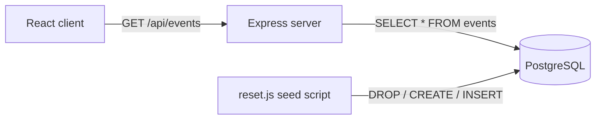

<div align="center">

# UnityGrid Plaza

An events directory built with React and Express that lets visitors pick a venue on an interactive map and browse events stored in PostgreSQL.


</div>

> Project 3 ("Event Master") for CodePath's **WEB103: Intermediate Web Development** course. Submitted by Abhishek Yadav. Time spent: about 4 hours.

## Overview

UnityGrid Plaza is a small full-stack app. An Express server reads an `events` table from PostgreSQL and exposes it as JSON. A React client renders a clickable SVG map of four venues (Texas, Crypto Arena LA, Chicago, Boston). Each venue has its own URL, and a separate page lists every event in the database.

## Features

- **Interactive venue map**: SVG polygons over a background image. Hovering a region reveals the venue name, and clicking navigates to that venue's page.
- **Per-venue routes**: `/Texas`, `/CryptoArenaLA`, `/Chicago` and `/Boston`, defined with React Router's `useRoutes`.
- **All events page**: `/events` fetches every event from the API and renders it as a card with image, title, performer and date.
- **PostgreSQL seeding**: `npm run reset` drops and recreates the `events` table, then inserts the sample events from `server/data/events.js`.
- **Production build**: Vite builds the client into `server/public`, and in production Express serves those static files with a catch-all route for client-side routing.

## Tech stack

| Layer | Technology |
| --- | --- |
| Client | React 18, React Router 6, Vite 4, Pico CSS |
| Server | Node.js, Express 4, `cors`, `serve-favicon` |
| Database | PostgreSQL via `pg` connection pool |
| Tooling | `concurrently`, `nodemon`, `dotenv` |

## Architecture



## Project structure

```text
.
├── client/
│   ├── index.html
│   ├── vite.config.js        # builds into ../server/public
│   └── src/
│       ├── App.jsx           # routes and header
│       ├── components/Event.jsx
│       ├── pages/            # Locations, LocationEvents, Events
│       ├── services/         # LocationsAPI, EventsAPI (stubs)
│       └── css/
├── server/
│   ├── server.js             # Express app, /api/events
│   ├── routes/events.js
│   ├── controllers/events.js
│   ├── config/               # database.js, dotenv.js, reset.js
│   └── data/events.js        # seed data
├── Proj3.gif                 # walkthrough recording
└── package.json
```

## Getting started

### Prerequisites

- Node.js and npm
- A PostgreSQL database (the course used Railway)

### Install

```bash
npm install
```

### Configure

Database settings are read from environment variables in `server/config/database.js`. `server/config/dotenv.js` loads them from a `.env` file one level above the working directory (for the seed script that is `server/.env`).

| Variable | Description |
| --- | --- |
| `PGUSER` | Database user |
| `PGPASSWORD` | Database password |
| `PGHOST` | Database host |
| `PGPORT` | Database port |
| `PGDATABASE` | Database name |
| `PORT` | Server port (defaults to `3001`) |
| `NODE_ENV` | `development` or `production`; controls favicon and static file serving |

### Run

```bash
npm run reset   # create and seed the events table
npm run dev     # Vite client + nodemon server together
```

Other scripts: `npm run client` (client only), `npm run build` (build client into `server/public`), `npm start` (run the server).

## API

| Method | Endpoint | Description |
| --- | --- | --- |
| GET | `/api/events` | All rows from the `events` table, ordered by `id` |

## Course checklist

**Required features**

- [x] The web app uses React to display data from the API
- [x] The web app is connected to a PostgreSQL database, with an appropriately structured Events table
  - [ ] The GIF or screenshot includes a view of the Railway database showing the table contents
- [x] The web app displays the title of the app
- [x] A visual interface allows the user to select a Location they would like to view
- [x] Clicking on a Location shows a list of all items from the Events table that correspond to that Location
- [x] Each Location detail page has its own unique URL

**Optional features**

- [x] An additional page shows all possible Events that the user can sort and filter by Location
- [ ] Events display a countdown showing the time remaining before the event, with different formatting once it has passed

## Walkthrough


## Notes and limitations

- The client calls `http://localhost:3001/api/events` directly. The Vite dev proxy in `client/vite.config.js` points to port 3000 and is not used.
- `LocationEvents` does not filter by venue yet. Every venue page shows the first two events under a "Texas" heading. The `/events` page lists all events without sort or filter controls.
- `server/routes/locations.js`, `server/controllers/locations.js` and the `services/` components are unfinished stubs and are not wired in.
- `server.js` does not import `config/dotenv.js`, so the `PG*` variables must be present in the server's environment.
- The `delete` script and `server/fserver.js` refer to files that are not in the repo.

The author's note: this was a challenging project.

---

Built by [Abhishek Yadav](https://github.com/abhiishek340)
